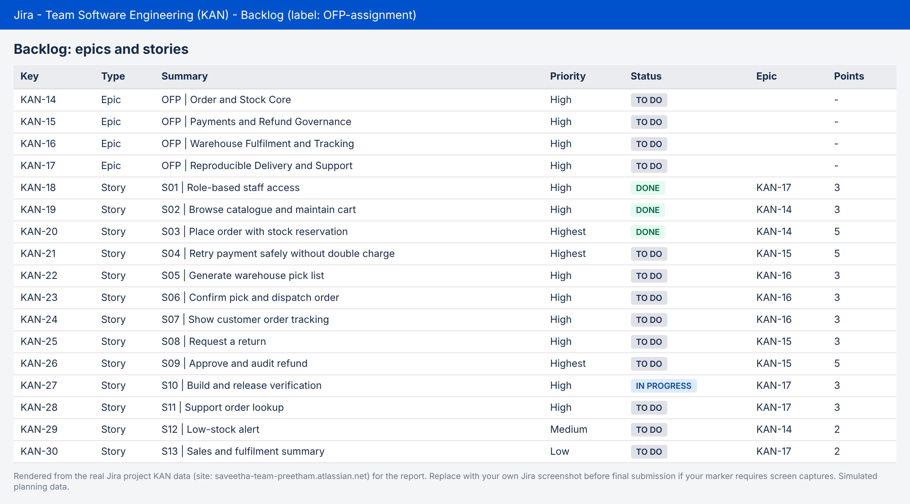
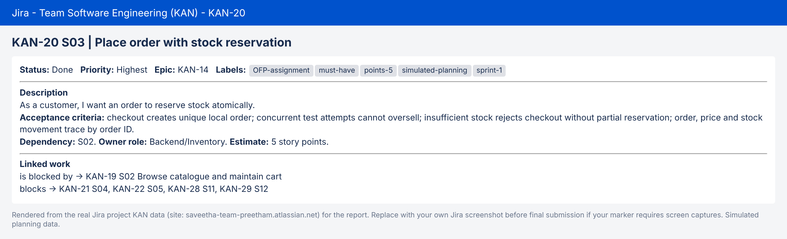
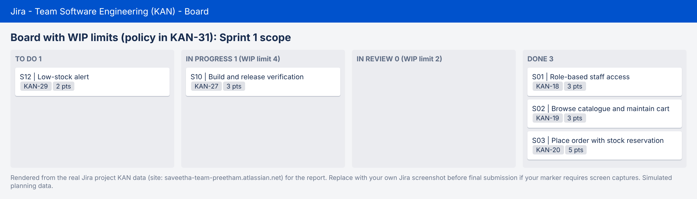
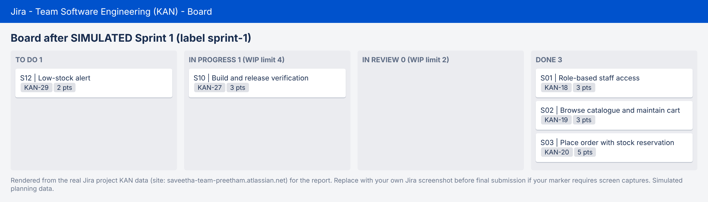
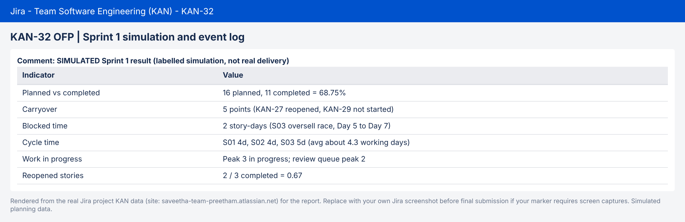
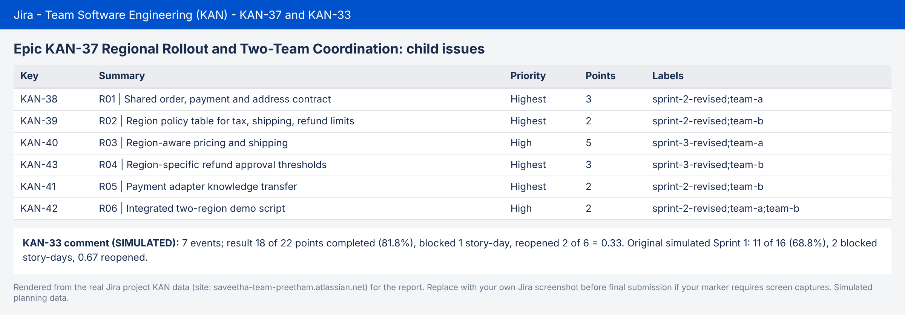

# Agile Delivery Strategy: Omnichannel Order Fulfilment Platform (CSA10 Assignment 1)

Date: 15 November 2026

## Overview and method

This report develops a Scrum delivery strategy with Lean flow controls for the omnichannel order fulfilment platform. It prioritizes one complete order-to-delivery-to-refund journey over all nine modules, and the plan is built and tracked in Jira project KAN ("Team Software Engineering") on the site saveetha-team-preetham.atlassian.net.

| Item | Entry |
| --- | --- |
| Student name | \[your name\] |
| Register number | \[your register number\] |
| Programme and section | \[your programme and section\] |
| Course outcome | CO1: apply agile methodologies and project management techniques such as scale and lean, using Jira |
| Tool used | Jira Cloud (team-managed software project KAN) |

**Method and honesty note.** Stakeholder responses, the Sprint 1 event log, and the redesign events and indicators are simulated and labelled as such. Story points, capacity hours and sprint indicators are planning figures, not measured team performance. Story points are never converted into fixed hours. Jira issue keys quoted below (for example KAN-20) are real issues in the project; every simulated comment in Jira carries the word SIMULATED.

## Task 1: Investigation and delivery outcomes

The product goal is to make every order traceable from checkout through stock reservation, payment, picking, dispatch and delivery, and where needed to an authorized and audited refund, with stock that customers and pickers can trust. The investigation starts from existing failure points (failed orders, slow refunds, unclear ownership) rather than from the request to build all nine modules.

### Investigation questions

1. Where do stock mismatches arise between what the website shows and what a picker finds?
2. Which payment and refund states cause the longest waiting or the risk of duplicate processing?
3. Which order information must a support agent see to resolve a query without switching systems?
4. What approval evidence must finance hold before a refund is paid?
5. What happens to an order when the payment gateway sandbox is unavailable?

### Stakeholder findings (SIMULATED responses, not real interviews)

| Stakeholder | Simulated finding | Planning decision |
| --- | --- | --- |
| Customer | Tracking says "processing" for days with no milestone | Show permitted milestones (paid, picked, dispatched, delivered), no internal notes (S07, KAN-24) |
| Warehouse picker | Pick lists include items already sold elsewhere | Reserve stock at checkout with an expiry and show only reserved, paid items (S03, S05) |
| Support agent | Customers call repeatedly because refund status is invisible | Order lookup showing return and refund state (S11, KAN-28) |
| Finance reviewer | Large refunds are approved by chat message | Role-based approval with an audit record (S09, KAN-26) |
| Developer | Payment gateway access arrives only in week 4 | Mock payment adapter and idempotency contract first (S04, KAN-21) |

### Problem statement

A retailer selling through a website, a mobile app and twelve stores suffers failed orders, slow refunds and unclear order ownership. A seven-member team has eight weeks, uncertain capacity, ninety minutes of stakeholder time per week and a payment sandbox that opens only in week 4. The team must choose a release that completes one end-to-end journey rather than leaving nine modules half built.

### Scope

| In the first release | Deferred or excluded |
| --- | --- |
| Role-based access, synthetic catalogue and cart | Demand forecasting (trained machine learning) and recommendations |
| Order placement with stock reservation | Multi-currency pricing and loyalty features |
| Idempotent payment request (mock, then sandbox) | Real payment processing and any real card or customer data |
| Pick list, pick confirmation and dispatch | Sales analytics dashboard (S13, KAN-30) |
| Customer tracking, return request, audited refund approval | Full inventory synchronization across all twelve stores |
| Support order lookup, deterministic low-stock alert, build verification | Barcode hardware integration beyond manual fixtures until week 5 |

All nine modules stay on the roadmap; a menu entry does not make a module complete. The low-stock alert is a fixed-threshold rule, not machine-learning forecasting.

### Measurable success criteria (test targets, not production claims)

| Criterion | Acceptance condition |
| --- | --- |
| Core journey | One synthetic order reaches Delivered and one return reaches Refunded, with an audit record for each valid status change |
| Stock integrity | 100 concurrent test orders for a 10-unit item create at most 10 reservations and never a negative stock count |
| Payment idempotency | Ten retries with one payment key create one payment intent and one order |
| Refund authorization | 100% of attempts by picker or support roles to approve a refund are rejected and logged |
| Release reproducibility | A clean checkout and the documented build reproduce the journey and keep records after restart |

Delivery-process criteria used later to judge the strategy: committed points completed per sprint at or above 80%, blocked time at most 2 story-days per sprint, and reopened stories per completed story at or below 0.33.

### Feasibility

- **Technical:** a transactional database and synthetic data support atomic reservation and idempotency keys; a mock gateway adapter removes the week-4 dependency.
- **Operational:** pickers and finance staff can give only ninety minutes a week, so acceptance examples are agreed in refinement and reviews are consolidated once per sprint. The reservation expiry rule needs warehouse agreement.
- **Financial:** the plan assumes existing development machines, free-tier or student tooling and sandbox accounts only. No real charges occur, and any paid hosting would be estimated separately.

## Task 2: Project management approach and tool selection

I select Scrum with Lean flow controls: the fixed eight-week deadline and scarce warehouse and finance time need predictable sprint review points, while Lean limits on work in progress expose waiting in review, testing and integration.

### Two delivery approaches compared

| Dimension | A. Scrum with Lean controls | B. Continuous Kanban with release milestones |
| --- | --- | --- |
| Selecting work | Ordered backlog; scope negotiated against a sprint goal and capacity before commitment | Pull the highest-value ready item whenever WIP allows |
| Coordination | Daily 15-minute sync, weekly refinement, one board | Daily flow review, explicit policies per column |
| Review | Sprint review and retrospective every two weeks | Weekly service review and flow metrics review |
| Changing requirements | Urgent work negotiated against the sprint goal; one expedite item allowed with an equal removal | Continuous reprioritization with an expedite lane |
| Cross-functional work | Shared sprint goal keeps API, inventory, payments and QA aligned | Flow is visible, but no shared goal forces alignment |
| Limitations | Overcommitment is likely before any velocity exists; ceremonies cost stakeholder time | Weak milestones can push payment integration late; release planning needs extra discipline |
| Delivery risk | Partly finished stories at sprint end if WIP is uncontrolled | Long-running work that never converges on the festival date |

**Decision.** Approach A, tailored with Kanban-style WIP limits and blocked-item rules. Sprint boundaries give warehouse and finance staff one predictable review per fortnight inside their ninety-minute weekly window, and the Lean limits address Approach A's main weakness.

### Operating model

| Element | Definition |
| --- | --- |
| Roles (seven people) | Product and analysis lead (Product Owner, resolves scope conflicts); frontend engineer; order API engineer; inventory and data engineer; payments and security engineer; QA engineer; DevOps engineer. One person may hold two roles; refund-approval responsibility stays explicit. |
| Planning | Sprint planning selects stories that fit the capacity assumption; the provisional ceiling is 16 points until real evidence exists |
| Refinement | Weekly, inside the ninety-minute stakeholder window; every story gets a negative-case acceptance example before it is Ready |
| Daily coordination | 15 minutes: what moved, what is blocked, which dependency is next |
| Review points | Sprint review with warehouse and finance representatives; retrospective; short API design session whenever a contract changes |
| Escalation | A blocked item is raised to the Product Owner after one working day; scope trade-offs are decided by the Product Owner; a story that fails acceptance checks is rejected by QA |
| Stakeholder participation | Warehouse and finance clarify rules and accept demos; asynchronous questions in Jira comments save meeting time |

### Lean practices

- **Waiting:** build the mock payment adapter and agreed contract before gateway access arrives in week 4; a dependency not cleared in one working day is escalated.
- **Handovers:** one board and one set of acceptance criteria replace duplicate status reports; engineers own completion evidence.
- **Rework:** acceptance examples including a negative case before work starts; QA pairing on critical flows.
- **Work in progress:** limits of 4 in progress, 2 in review and 2 in test; finish and review work before pulling a new story.

### Tool comparison and selection

| Criterion | Jira | Trello | GitHub Projects |
| --- | --- | --- | --- |
| Planning | Epics, stories, priorities, issue hierarchy and dependency links | Cards and lists; hierarchy and dependencies depend on conventions or add-ons | Issues and project views; epics by convention |
| Workflow management | Configurable statuses and transitions, board with WIP column limits | Simple lists, quick to set up | Status fields and board views, repository-centred |
| Collaboration | Comments, assignees, links, history | Comments, checklists, light onboarding | Strong link between issues and pull requests |
| Reporting | Issue history and reports, subject to plan and board type | Limited without power-ups | Basic insights, charts depend on setup |
| Accessibility | Keyboard navigation and screen-reader support are documented; verify for the exact configuration | Simple interface, verify keyboard use | Verify for the exact configuration |
| Cost | A free tier is available for small teams; confirm current limits before relying on a feature | Free tier available; confirm limits | Free for many uses; confirm limits |

**Selected tool: Jira.** It offers the epic-story hierarchy, "Blocks" dependency links, priorities, issue history and comments that the assignment's evidence requirements need, and my planning artefacts already live there. GitHub Projects is the fallback if Jira access or cost becomes restrictive.

**Limitations found and how I handled them**

- The KAN board is a team-managed board without Scrum sprints, so sprint membership is recorded with labels `sprint-1` to `sprint-4` and `deferred` (see KAN-31).
- The workflow offers only To Do, In Progress, In Review and Done. "Test" is the `in-test` label and "Blocked" is the `blocked` label with a reason, owner and next action in a comment.
- No story-points field is enabled, so each story states its estimate in the description and in a `points-N` label.
- WIP limits are policy in KAN-31 and must be set as column limits in the board settings.

## Task 3: Prioritized product backlog in Jira

The Jira backlog holds four first-release epics and thirteen stories (43 points); twelve stories form the first release and one, the sales summary, is deferred. Every story in Jira carries acceptance criteria, an estimate, a dependency note and an owner role in its description, a priority, a `sprint-N` label and "Blocks" links.

### Epics

| Jira key | Epic | Problem it addresses |
| --- | --- | --- |
| KAN-14 | Order and Stock Core | Failed orders from overselling |
| KAN-15 | Payments and Refund Governance | Slow, unauthorized or duplicated payments and refunds |
| KAN-16 | Warehouse Fulfilment and Tracking | Unclear order ownership and invisible order progress |
| KAN-17 | Reproducible Delivery and Support | Support calls, weak access control, unverifiable releases |

### Stories

| Key | ID | Story | Priority (Jira) | MoSCoW | Points | Depends on | Owner role | Sprint | Epic |
| --- | --- | --- | --- | --- | --- | --- | --- | --- | --- |
| KAN-18 | S01 | Role-based staff access | High | Must | 3 | Identity model | Full-stack / Security | 1 | KAN-17 |
| KAN-19 | S02 | Browse catalogue and maintain cart | High | Must | 3 | Synthetic catalogue | Frontend | 1 | KAN-14 |
| KAN-20 | S03 | Place order with stock reservation | Highest | Must | 5 | S02 | Backend / Inventory | 1 | KAN-14 |
| KAN-27 | S10 | Build and release verification | High | Must | 3 | Repository setup | DevOps / QA | 1 | KAN-17 |
| KAN-29 | S12 | Low-stock alert (fixed threshold) | Medium | Should | 2 | S03 | Inventory / Backend | 1, carried to 2 | KAN-14 |
| KAN-21 | S04 | Retry payment safely without double charge | Highest | Must | 5 | S03; sandbox in week 4 | Payments / Backend | 2 | KAN-15 |
| KAN-22 | S05 | Generate warehouse pick list | High | Must | 3 | S03, S04 | Warehouse / Backend | 2 | KAN-16 |
| KAN-23 | S06 | Confirm pick and dispatch order | High | Must | 3 | S05; scanner in week 5 | Warehouse / Backend | 3 | KAN-16 |
| KAN-24 | S07 | Show customer order tracking | High | Must | 3 | S03, S06 | Frontend | 3 | KAN-16 |
| KAN-25 | S08 | Request a return | High | Must | 3 | S07 | Support / Backend | 3 | KAN-15 |
| KAN-26 | S09 | Approve and audit refund | Highest | Must | 5 | S04, S08 | Finance / Payments | 3 | KAN-15 |
| KAN-28 | S11 | Support order lookup | High | Should | 3 | S03 | Support / Frontend | 4 | KAN-17 |
| KAN-30 | S13 | Sales and fulfilment summary | Low | Could | 2 | Persisted order events | Analytics / Full-stack | Deferred | KAN-17 |

Acceptance criteria sit in each Jira description. Examples: S03 (KAN-20) requires that concurrent test attempts cannot oversell and that insufficient stock rejects checkout without partial reservation; S04 (KAN-21) requires that a retried request with the same key cannot create a second charge in the simulator; S09 (KAN-26) requires that only the finance role can approve and that reviewer, timestamp, reason and linked IDs are stored.

### Prioritization method

I used MoSCoW ranking decided by three questions: how much customer or financial harm results if the story is absent, whether the end-to-end journey (order, payment, pick, dispatch, track, return, refund) breaks without it, and how much effort and uncertainty it carries. Stories that break the journey and carry harm are Must; stories that improve visibility or prevention without breaking the journey are Should; an attractive but dependent feature is Could. Jira priority mirrors this (Highest for stock, payment idempotency and refund authorization).

### Retained and deferred modules

| Module | Decision | Reason |
| --- | --- | --- |
| Storefront catalogue, cart and checkout | Retained, minimal (S02, S03) | The journey starts here |
| Payment integration | Retained, mock first then sandbox (S04) | Double charging is direct financial harm |
| Inventory synchronization | Retained as reservation and low-stock rule (S03, S12) | Overselling creates failed orders; full multi-store sync deferred |
| Order tracking | Retained (S07) | Customers need visible milestones |
| Warehouse picking dashboard | Retained as pick list and confirmation (S05, S06) | Pickers need accurate lists, not a dashboard |
| Returns and refunds | Retained (S08, S09) | Slow, unaudited refunds are a named problem |
| Support console | Retained as order lookup (S11) | Cuts repeat calls |
| Sales analytics | Deferred (S13, KAN-30) | No value until order and stock records are trustworthy |

### Definition of Ready

The user, outcome and value are clear; acceptance examples are agreed, including at least one negative case; the estimate, owner role and dependencies are recorded; privacy and security questions are answered; synthetic test data is identified; and the story is small enough to finish in one sprint.

### Definition of Done

Acceptance criteria pass; code is reviewed; relevant automated and manual tests are recorded; persistent state and server-side authorization are verified; no real card or customer data appears in test evidence; user-facing screens have readable labels and keyboard access checked; audit behaviour is verified where relevant; deployment notes are updated; no critical defects remain; the Product Owner records acceptance. A finished interface alone is not Done.

### Two decisions where stakeholder requests competed

1. **Management charts versus pickers' stock reservation.** Management asked for the analytics dashboard early. I kept stock reservation (S03) in Sprint 1 and deferred analytics (S13), because overselling produces failed orders and refunds that no chart can repair.
2. **Fast refunds versus finance control.** Support wanted refunds approved quickly; finance wanted auditable approval. I kept one minimal approval workflow (S09) with role and audit rules instead of promotional or convenience features, because a quick but unauthorized refund is a direct financial loss.

## Task 4: Capacity-based release plan and delivery workflow

The release plan fits 41 points of first-release work into four sprints against an assumed 336 focused hours per sprint, defers 2 points, and sequences work around the week-4 gateway and week-5 scanner constraints. All figures are planning assumptions until real velocity exists.

### Capacity assumptions

7 people × 10 working days × 6 focused hours = 420 nominal hours per sprint. I hold back a 20% reserve for reviews, unplanned defects and integration, leaving 336 focused hours. Story points express relative effort and uncertainty and are not converted into hours. Because no velocity exists, 16 points is a provisional planning ceiling, reviewed after Sprint 1.

### Estimation method

The team sizes stories relatively against a reference story (S02, the cart, is 3 points), using a small scale of 2, 3 and 5. A story above 5 points must be split before it is Ready. Estimates capture effort, uncertainty and dependency risk together, so a 5-point story such as S03 is not simply "five units of time".

### Sprint plan

| Sprint | Goal | Stories | Points | Dependency and constraint handling |
| --- | --- | --- | --- | --- |
| 1 (weeks 1-2) | Secure ordering foundation | S01, S02, S03, S10, S12 | 16 (at the ceiling) | S02 before S03; S12 starts only after the S03 stock ledger exists |
| 2 (weeks 3-4) | Safe payment retry and pick list | S04, S05 plus reserve for Sprint 1 carryover | 8 new + about 5 reserved = 13 | S04 uses the mock adapter in week 3; a sandbox smoke test runs when access opens in week 4 |
| 3 (weeks 5-6) | Dispatch, tracking, return and audited refund | S06, S07, S08, S09 | 14 | Scanner arrives in week 5: manual fixtures first, then scanner confirmation; S09 needs S04 and S08 |
| 4 (weeks 7-8) | Support visibility, regression and release rehearsal | S11 | 3 | Light on purpose: absorbs carryover, regression checks and the release rehearsal |
| Deferred | Not in the first release | S13 | 2 | Revisit only if value and capacity appear |

Totals: 16 + 8 + 14 + 3 = 41 points of first-release stories, plus 2 deferred. Dependencies are stored in Jira as "Blocks" links (S02 blocks S03; S03 blocks S04, S05, S11 and S12; S05 blocks S06; S06 blocks S07; S07 blocks S08; S04 and S08 block S09).

### Responsibilities across the sprints

The order API engineer and inventory engineer own S02, S03 and S12; the payments and security engineer owns S01, S04 and S09; the frontend engineer owns S07 and S11; the DevOps engineer owns S10; the QA engineer pairs on S03, S04 and S09 and holds the single test slot; the Product Owner clarifies rules with warehouse and finance in the weekly window.

### Development workflow (not the order lifecycle)

The development workflow tracks the state of a story. The order lifecycle (Placed, Reserved, Paid, Picked, Dispatched, Delivered, Returned, Refunded) tracks the state of a customer order inside the product. The two are kept separate so a story called "Dispatch" being Done never implies any real order was dispatched.

| Status (Jira) | Entry rule | Exit check |
| --- | --- | --- |
| To Do (Ready) | Meets the Definition of Ready | Pulled only when WIP allows |
| In Progress | An owner is named | Acceptance evidence attached before review |
| In Review | Code review requested | Review comments resolved |
| Test (label `in-test`) | Review passed | Acceptance and negative-case checks pass |
| Blocked (label `blocked`) | A reason, owner and next action are recorded | Blocker cleared; item returns to its previous status |
| Done | All checks pass and the Product Owner accepts | Meets the Definition of Done |

The Jira board has only To Do, In Progress, In Review and Done, so Test and Blocked are labels (see Task 2 limitations).

### Work-in-progress limits

| Stage | Limit | Reason |
| --- | --- | --- |
| In Progress | 4 | Seven people, with pairing and review time, cannot usefully hold more than four open stories |
| In Review | 2 | Reviews must happen within a day; a longer queue means waiting |
| Test | 2 | One QA engineer; this is the tightest control and the first place waiting will show |

### Blocked, urgent and unfinished work

- **Blocked:** stays visible, keeps counting against its stage's limit, and carries a reason, an owner and a next action; it is escalated to the Product Owner after one working day.
- **Urgent:** one expedite item may enter only if the Product Owner removes planned work of equal size.
- **Unfinished:** a story that is not Done at sprint end returns to the ordered backlog with its remaining work; it is never marked partly done, and carryover is not counted as new velocity.

### How the selected features achieve the product goal

S01-S03 create a trusted order and stock record, S04 makes payment safe, S05-S07 move the order through picking, dispatch and tracking, S08-S09 close the loop with an authorized refund, S10 makes the result reproducible and S11 lets support explain every order. Together they deliver the complete order-to-delivery-to-refund journey; the deferred analytics story does not break it.

## Task 5: Sprint 1 simulation and validation (SIMULATED)

The simulated Sprint 1 completed 11 of 16 planned points (68.75%), below my 80% target, and showed that the real bottleneck was the S03 stock reservation story blocking everything after it, not only the test queue I predicted. Everything in this section is a simulation recorded in Jira, not actual team delivery.

### Prediction before the simulation

- **Predicted bottleneck:** the review and test queue, because only one QA engineer exists and stock reservation, persistence and payment keys all converge on testing.
- **Rule expected to control it:** WIP limits of 2 in review and 2 in test, and finishing work before pulling a new story.
- **Evidence that the rule works:** the review queue never exceeds 2, an item waits no more than about 1 day for review, and blocked time stays at or below 2 story-days.

### Event log (SIMULATED)

| # | Day | Event | Effect on the board |
| --- | --- | --- | --- |
| 1 | 1 | Refinement finds the S03 reservation expiry rule ambiguous | S03 not Ready until acceptance examples are agreed (KAN-20) |
| 2 | 1 | Start S01, S02 and S10 | 3 items In Progress (limit 4) |
| 3 | 2 | Synthetic product fixture created and checked for S02 | Test data complete |
| 4 | 3 | S01 and S02 sent to review | In Review holds 2 (at its limit) |
| 5 | 3 | Review finds a quantity-validation gap in S02 | S02 back to In Progress; reopened count 1 |
| 6 | 4 | S01 role checks pass | S01 Done (KAN-18) |
| 7 | 4 | S02 fixed and accepted; S03 starts because its dependency cleared | S02 Done (KAN-19); S03 In Progress |
| 8 | 5 | Concurrent checkout test exposes an oversell race on S03 | S03 Blocked (label `blocked`, reason and owner in comment) |
| 9 | 6 | Backend and QA pair on an atomic reservation test | Work continues; blocked item still counted in WIP |
| 10 | 7 | Blocker cleared; S03 sent to review | Blocked time 2 story-days (days 5 to 7) |
| 11 | 8 | S03 accepted; simulated check of 100 concurrent orders on a 10-unit item gives at most 10 reservations | S03 Done (KAN-20) |
| 12 | 8 | S10 build verification finds a missing regression test and missing deployment notes | S10 reopened to In Progress (KAN-27); reopened count 2 |
| 13 | 10 | Sprint review: S12 never started because the stock ledger was only stable from day 8 and four items were already open | S12 stays To Do (KAN-29); 5 points carried over |

### Jira updates made for the simulation

Board state at the end of event 13: KAN-18, KAN-19 and KAN-20 are Done; KAN-27 is In Progress after being reopened; KAN-29 is To Do. Each affected issue has a comment starting with SIMULATED, and KAN-32 holds the indicator table. Capture screenshots of the board, the issue history of KAN-19 and KAN-20, and the KAN-32 comment for the submission.

### Indicators (SIMULATED)

| Indicator | Result | Against target | Interpretation |
| --- | --- | --- | --- |
| Completed versus planned | 11 of 16 points = 68.75% | Misses 80% | Three stories finished; S10 and S12 (5 points) carry over |
| Blocked time | 2 story-days (S03) | Meets at most 2 | A single dependency stopped the chain behind it |
| Cycle time | S01 4 days, S02 4 days, S03 5 days; average about 4.3 working days | No target set yet | Gives a baseline for Sprint 2 |
| Work in progress | Peak 3 in progress; review queue peak 2 | Within limits (4 and 2) | The limits held and held S12 back |
| Reopened stories | 2 reopened; 2 of 3 completed = 0.67 | Misses 0.33 | Ready checks lacked negative-case examples |

### Interpretation and limitation of the original plan

The prediction was partly right: the review queue reached its limit of 2 on days 3 and 8, and the limit kept a fifth story from starting. But the larger delay was a dependency bottleneck: S03 blocks S04, S05, S11 and S12, so one defect in one story stalled the critical path. My original plan put the single critical-path story in a sprint filled to the 16-point ceiling with no reserve and no early pairing. With only three finished stories and about four days of average cycle time, this small simulated log cannot prove causes; it only shows where the plan was weak.

### Improvement for Sprint 2

- Plan 8 new points (S04, S05) plus the 5-point carryover, a total of 13, below the 16-point ceiling.
- Pair the backend and QA engineers on critical flows from the first day of S04 and S09.
- Add a negative-case and a concurrency example to the Definition of Ready for stories that touch stock or payment.
- Start S04 on day 1 against the mock adapter and idempotency tests, so the sandbox arrival in week 4 only adds a smoke test.

## Task 6: Redesign delivery under changed conditions (SIMULATED)

The redesigned plan keeps the order-to-refund journey and the festival deadline by giving each team clear ownership, fixing shared contracts before parallel work, and deferring analytics, the low-stock alert and promotions. Capacity grows about 1.37 times, not 2 times, so scope must shrink in step. All figures below are planning and simulation figures.

### A. Impact of the changes

| Change | Assumption or plan element it breaks | Evidence from my original plan | Risk |
| --- | --- | --- | --- |
| Two more regional warehouses | Single set of tax, shipping and refund rules; one stock location | S03 (KAN-20) was the critical-path story and blocked 2 story-days in Sprint 1 | Regional rule combinations multiply test cases |
| Second seven-person team | Capacity of 336 focused hours; one board and one QA engineer | Test limit of 2 with one QA engineer was the tightest control | Onboarding and shared APIs can become a coordination bottleneck |
| Payments engineer unavailable | S04 (KAN-21) and S09 (KAN-26) had one owner | S03 blocked the payment slice; payment knowledge sat with one person | Single-person dependency on idempotency and reconciliation |
| Region-specific tax, shipping and refund approval | Refund approval was one workflow with one limit | S09 requires audit and role control | Wrong regional limit means direct financial loss |
| Deadline unchanged | Four sprints, 41 points planned | Sprint 1 finished 11 of 16 points | No time to absorb a scope or integration miss |

Recalculated capacity for the next sprint: Team A has six people (the original seven minus the payments engineer): 6 × 10 × 6 = 360 nominal hours. Team B has seven people at 60% availability during onboarding: 7 × 10 × 6 × 0.60 = 252 hours. Total 612 hours; with a 25% reserve for coordination and integration the focused total is about 459 hours, against 336 originally, which is about 1.37 times. Provisional ceiling: 16 × 459 / 336, about 22 points.

### B. Redesign objectives (measurable)

| Objective | Measure |
| --- | --- |
| One shared contract | A single versioned order, payment and address contract (KAN-38); contract tests fail on any renamed or missing field |
| Region rules as configuration | Adding a region needs zero changes to order code, verified for both new regions (KAN-39) |
| Limited cross-team coupling | No more than 2 cross-team dependencies in active implementation at once |
| Coordination cadence | 2 dependency reviews per week, 1 integrated demo per sprint, contract conflicts settled within 1 working day |
| Protected journey | One end-to-end journey passes for each of the two regions; 100% of refund role tests pass at the release gate |
| Payment resilience | A backup engineer runs the idempotency contract tests without the original engineer |
| Delivery process | At least 80% of committed points complete, blocked time at most 2 story-days, reopened per completed story at most 0.33 |

### C. Revised strategy

**Scaled Agile practices adopted (SAFe-inspired, not full SAFe).** One shared product backlog with one Product Owner; a short joint planning session each sprint; twice-weekly dependency review (a scrum-of-scrums style sync); one integrated demo per sprint; explicit interface ownership with one integration owner; and a shared integration lane with a WIP limit of 2. Not adopted: enterprise roles, multi-day planning events and extra ceremonies, because two teams of seven do not justify them and stakeholder time is still ninety minutes a week. This fits the project because the real risks are shared contracts and single-person knowledge, not portfolio governance.

**Lean practices.** WIP limits per team plus the integration lane, small batches (the new stories are 2 to 5 points), contract-first work so no team waits for another's code, and one visual board filtered by `team-a` and `team-b` labels.

**Team responsibilities.**

| Team | Owns | Notes |
| --- | --- | --- |
| Team A (6 effective) | Order, stock, tracking, pick and dispatch, integration owner role | Keeps the proven S03 reservation knowledge |
| Team B (7, 60% available at first) | Region policy rules, refund approval and audit, UI, delivery and regional test coverage | 40% of its first sprint reserved for learning and integration; one engineer pairs on the payment adapter first (R05, KAN-41) and then owns it |

**Revised backlog (Jira epic KAN-37).** R01 KAN-38 shared contract (3); R02 KAN-39 region policy table (2); R03 KAN-40 region-aware pricing and shipping (5); R04 KAN-43 regional refund thresholds (3); R05 KAN-41 payment backup ownership (2); R06 KAN-42 integrated two-region demo (2). Links record that R01 blocks R02 and R06, R02 blocks R03 and R04, S04 blocks R05 and S09 blocks R04.

**Revised sequencing (ceiling about 22 points).**

| Sprint | Work | Points |
| --- | --- | --- |
| 2 (weeks 3-4) | S04, S05, S10 carryover, R01, R02, R05, R06, S12 | 22 |
| 3 (weeks 5-6) | S06, S07, S08, S09, R03, R04 | 22 |
| 4 (weeks 7-8) | S11, regression for both regions, release rehearsal; S12 only if the midpoint review allows | 3 plus rehearsal |
| Deferred | S13 sales summary, promotional features, any further region | none |

### D. Validation: simulated events and comparison

The revised sprint is simulated and recorded as a comment on KAN-33.

| # | Event (SIMULATED) | Revised behaviour |
| --- | --- | --- |
| 1 | Team B onboarding takes 40% of its first sprint | Effective capacity set at 60%; learning time protected |
| 2 | A region requests a special tax and shipping rule | Policy table extended; no duplicated order code (KAN-39) |
| 3 | Team B proposes a conflicting address payload | Contract review settles naming before implementation (KAN-38) |
| 4 | The original payments engineer becomes unavailable | Paired handover and idempotency tests preserve the contract (KAN-41) |
| 5 | Gateway sandbox access is delayed again | Local payment adapter and replay tests keep S04 moving |
| 6 | The combined demo finds a support-role user able to call the refund-approval stub | Release gate blocks the stub until a role check is added (KAN-43) |
| 7 | Midpoint capacity review | S12 and S13 stay deferred; no promotional work starts |

| Equivalent indicator | Original simulated sprint | Revised simulated sprint |
| --- | --- | --- |
| Planned and completed points | 16 planned, 11 completed | 22 planned, 18 completed across both teams |
| Completion ratio | 68.8% | 81.8% |
| Blocked story-days | 2 | 1 |
| Reopened stories per completed story | 2 / 3 = 0.67 | 2 / 6 = 0.33 |
| Cross-team dependencies active at once | not applicable | 2 (meets the limit of 2) |

The revised figures are simulated under changed staffing. They show that the design meets my targets in the scenario, not that a real team would improve.

### E. Defence of the decision

- **Benefits:** explicit ownership, a single contract that stops conflicting payloads, region rules kept out of order code, a backup for payments knowledge, and early integrated demos that caught a refund role gap before release.
- **Limitations and trade-offs:** onboarding and coordination consume capacity (about 1.37 times, not 2 times); sprint 3 is planned at the ceiling of 22 points, so it has little slack; the low-stock alert, sales summary and promotions are given up to protect the journey.
- **Why the deadline stays feasible:** the critical path (S03, S04, S08, S09) is unchanged and protected; deferred work frees about 4 points; sprint 4 stays light for carryover and rehearsal; and a pre-agreed deferral order applies if the midpoint review shows a shortfall: S12, then S13, then S11, then regional refund limits fall back to the strictest single limit, which keeps the control while reducing scope.
- **Residual risk:** under-estimating cross-team integration and regional test combinations. The twice-weekly dependency review and the integrated demo are the early-warning checks.

## Task 7: Individual technical reflection

*Draft in first person: read it, change any sentence that does not match what you learned, and be ready to explain it in the verification questions.*

**Most significant decision.** I chose to deliver one complete order-to-delivery-to-refund journey instead of all nine modules. In my backlog this meant keeping S03 stock reservation (KAN-20) and S09 refund approval (KAN-26) as Highest priority and deferring the sales summary (S13, KAN-30). I judged that overselling and unauthorized refunds cause harm that no dashboard can repair, and the plan fits 41 points into four sprints instead of spreading nine modules thin.

**How evidence changed my strategy.** My prediction said the review and test queue would be the bottleneck. In the simulated Sprint 1 log the review queue did reach its limit of 2, but the larger delay was S03 blocking S04, S05, S11 and S12 for 2 story-days, and 11 of 16 points (68.75%) finished. I therefore planned only 8 new points beside the 5-point carryover for Sprint 2, added a negative-case and concurrency example to the Definition of Ready, and scheduled backend and QA pairing on critical flows. In the redesign I added a shared contract (KAN-38) and a tighter integration lane for the same reason.

**Where the design remains vulnerable.** The mock and sandbox gateway may behave differently from a live service, so idempotency is proven only in simulation. Sprint 3 in the redesign is planned at the 22-point ceiling with little slack, and regional refund rules multiply test combinations. My capacity figures and every indicator are planning assumptions from small simulated logs, so they cannot predict a real team's output.

**Ethical concern addressed.** Privacy and transparency. All test data is synthetic, with no real card or customer data, and the Definition of Done forbids it in test evidence. Roles are least-privilege (pickers and support cannot approve refunds, S01 KAN-18 and S09 KAN-26). I labelled every simulated result as SIMULATED in Jira and in this report so it cannot be mistaken for real delivery. Workload is made visible by showing carryover openly instead of hiding unfinished work as partly done, and the tracking page criterion (KAN-24) requires screen-reader-readable status.

**What I would investigate next before using this with a real team.** Measure actual order volume and refund approval times with warehouse and finance staff, replace my simulated stakeholder responses with real interviews, test the payment idempotency design against the real gateway sandbox when it opens in week 4, and track a real velocity for two sprints before trusting the 16-point ceiling.

## Submission evidence and acknowledgements

Screenshots to capture from your own Jira project KAN before submitting (the assignment asks for screenshots or an export):

| Evidence | Where in Jira | Supports |
| --- | --- | --- |
| Backlog with 5 epics and 19 stories, priorities and labels | Project > Backlog or List view, filtered on label OFP-assignment | Task 3 |
| One story with acceptance criteria and linked issues | KAN-20 and KAN-26 | Task 3 |
| Dependency links | KAN-20, showing blocks and is blocked by | Tasks 3 and 4 |
| Board after the simulation | Board view | Tasks 4 and 5 |
| Event log and indicator comments | KAN-32, KAN-19, KAN-20, KAN-27 | Task 5 |
| Capacity, DoR, DoD, WIP policy | KAN-31 and its comment | Tasks 3 and 4 |
| Redesign artefacts | Epic KAN-37, R01 to R06, KAN-33 comment | Task 6 |

A note on the plan text in Jira: the description of KAN-31 holds my first-draft sprint goals; the comment on KAN-31 records the final allocation used in this report. Edit the description to match if your marker compares them.

**Sources and tools.** Assignment brief and answer-key style guidance supplied by the course (SIMATS Engineering, CSA10 Software Engineering). Jira Cloud was used to build and track the backlog; Claude (Anthropic) assisted with drafting the report text and populating Jira through the Atlassian connector, and I reviewed the content. All stakeholder responses, event logs and indicators are simulated unless stated otherwise.
