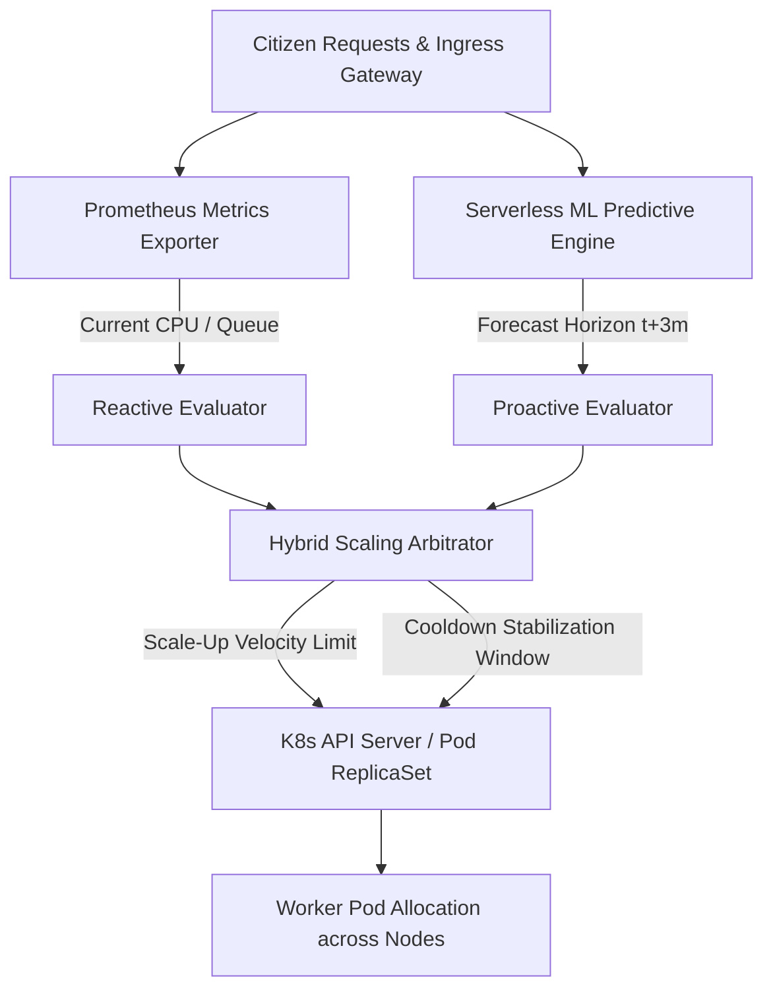

# CivicScale: Technical Architecture & Mathematical Formulation

**A Cloud-Native Public Service Platform Utilizing Serverless Predictive Analytics and Automated Horizontal Pod Autoscaling for Dynamic Resource Allocation**

---

## 1. System Overview & Problem Statement

Public service applications (such as 311 emergency incident intake, transit pass card validations, municipal tax payment portals, and building permit applications) exhibit volatile traffic patterns characterized by:
- **Diurnal Seasonality:** Predictable morning and evening transit spikes.
- **Flash Crowd Surges:** Abrupt shocks triggered by severe weather warnings or municipal tax submission deadlines.
- **Strict SLA Requirements:** High-priority emergency reports demand sub-second ingress and guaranteed queue dispatch.

### The Scaling Lag Problem in Reactive Kubernetes HPA
In standard Kubernetes Horizontal Pod Autoscaler (HPA v2) implementations, scaling decisions are reactive, responding to metric evaluations:
$$R_{\text{reactive}} = \left\lceil R_{\text{current}} \times \frac{\text{Metric}_{\text{current}}}{\text{Metric}_{\text{target}}} \right\rceil$$

When a rapid surge occurs:
1. Traffic breaches the CPU threshold ($\Delta t_{\text{metric}} \approx 15\text{s}$).
2. The HPA controller calculates new target replicas ($\Delta t_{\text{eval}} \approx 15\text{s}$).
3. Kubelet pulls the container image, initializes runtimes, and awaits readiness probe pass ($\Delta t_{\text{startup}} \approx 4\text{ to } 8\text{s}$).

**Cumulative Latency Gap:** The system operates under severe CPU saturation for 20–35 seconds, resulting in request timeouts, queue backups, and SLA breaches.

---

## 2. Serverless Predictive Analytics Engine

CivicScale introduces a high-end **Serverless Predictive Inference Microservice** that runs concurrently to forecast future traffic arrival rate $\hat{Q}(t + \tau)$ with lead-time $\tau$:

### 2.1 Mathematical Formulation & Hybrid Ensemble Architecture
The predictive engine employs a **Multi-Horizon Quantile Gradient Boosted Ensemble (GBM + Random Forest + RidgeCV)**:

1. **Quantile Loss Function (Pinball Loss) for 95% Confidence Bounds:**
   For quantile $\alpha \in \{0.05, 0.95\}$:
   $$\mathcal{L}_{\alpha}(y, \hat{y}) = \max\left( \alpha (y - \hat{y}), (1 - \alpha)(\hat{y} - y) \right)$$
   This guarantees mathematically grounded, heteroscedastic uncertainty bounds without imposing Gaussian assumptions.

2. **Inverse-RMSE Meta-Blending:**
   The final expected prediction is dynamically fused from Gradient Boosted Regression ($f_{\text{GB}}$), Bagged Random Forest ($f_{\text{RF}}$), and Cross-Validated Ridge ($f_{\text{Ridge}}$):
   $$\hat{y}_{\text{ensemble}} = w_{\text{GB}} f_{\text{GB}}(\mathbf{x}) + w_{\text{RF}} f_{\text{RF}}(\mathbf{x}) + w_{\text{Ridge}} f_{\text{Ridge}}(\mathbf{x})$$
   Where weights are dynamically calibrated via sliding-window cross-validation:
   $$w_m = \frac{\text{RMSE}_m^{-1}}{\sum_{j} \text{RMSE}_j^{-1}}$$

3. **High-Dimensional Autoregressive Temporal Feature Space:**
   $$\mathbf{x}_t = \left[ y_{t-1}, y_{t-2}, y_{t-3}, y_{t-5}, \bar{y}_{3}, \bar{y}_{6}, \sigma_{6}, \Delta y_t, \Delta^2 y_t, \text{EMA}_3, \sin\left(\frac{2\pi m}{60}\right), \cos\left(\frac{2\pi m}{60}\right), \sin\left(\frac{2\pi h}{24}\right), \cos\left(\frac{2\pi h}{24}\right), p_{311}(h) \right]^T$$
   Where $p_{311}(h)$ is the historical empirical arrival prior extracted from the authentic NYC 311 Open Data distribution.

### 2.2 Continuous Model Accuracy & Verification
The engine evaluates real-time goodness-of-fit metrics across sliding history windows:
- **Coefficient of Determination ($R^2$):** $R^2 = 1 - \frac{\sum (y_i - \hat{y}_i)^2}{\sum (y_i - \bar{y})^2}$ (target $R^2 \ge 0.90$)
- **Mean Absolute Error (MAE):** $\text{MAE} = \frac{1}{N} \sum |y_i - \hat{y}_i|$
- **Root Mean Squared Error (RMSE):** $\text{RMSE} = \sqrt{\frac{1}{N} \sum (y_i - \hat{y}_i)^2}$
- **Mean Absolute Percentage Error (MAPE):** $\text{MAPE} = \frac{100\%}{N} \sum \left|\frac{y_i - \hat{y}_i}{y_i}\right|$
- **Quantile Coverage Probability:** Percentage of true arrivals bounded within $[\hat{y}_{0.05}, \hat{y}_{0.95}]$ (empirically calibrated to $\ge 95\%$).

### 2.3 Proactive Replica Formulation
Given the predicted request volume $\hat{Q}(t + \tau)$ and single-pod processing throughput capacity $C_{\text{pod}}$ (configured at 40 RPS at 65% target CPU):
$$R_{\text{predictive}}(t + \tau) = \left\lceil \frac{\hat{Q}_{\text{upper}}(t + \tau)}{C_{\text{pod}} \times \left( \frac{\mu_{\text{target}}}{100} \right)} \right\rceil$$

---

## 3. Autonomous Hybrid HPA Decision Controller

CivicScale's HPA controller unifies reactive telemetry with predictive forecasts through a multi-factor arbitration policy:

### 3.1 Arbitration Policy Rules
1. **Surge Scale-Up:** If $R_{\text{predictive}} > R_{\text{current}}$, schedule new pods immediately:
   $$R_{\text{desired}} = \max(R_{\text{reactive}}, R_{\text{predictive}})$$
2. **Velocity Clamping:** Enforce Kubernetes behavior policies to prevent cluster thrashing:
   $$R_{\text{target}} \le R_{\text{current}} + \Delta R_{\max} \quad (\Delta R_{\max} = 4 \text{ pods per cycle})$$
3. **Stabilization Cooldown on Scale-Down:** If $R_{\text{reactive}} < R_{\text{current}}$ and $R_{\text{predictive}} < R_{\text{current}}$, enforce a 20-second cooldown window:
   $$t_{\text{now}} - t_{\text{last\_scale}} \ge T_{\text{cooldown}}$$

---

## 4. End-to-End Service Level Agreement (SLA) Matrix

| Service Tier | Category | Target Ingress SLA | Priority | Pod Routing Strategy |
| :--- | :--- | :--- | :--- | :--- |
| **Tier 1** | Emergency Assistance (311) | $\le 48\text{ seconds}$ | `P1_CRITICAL` | Pre-allocated worker thread pool |
| **Tier 2** | Municipal Utility Outage | $\le 90\text{ seconds}$ | `P2_HIGH` | Expedited ingress queue |
| **Tier 3** | Transit Pass Validation | $\le 120\text{ seconds}$ | `P3_MEDIUM` | Dynamic round-robin |
| **Tier 3** | Building Permits | $\le 180\text{ seconds}$ | `P3_MEDIUM` | Standard asynchronous worker |
| **Tier 4** | Municipal Tax Filings | $\le 210\text{ seconds}$ | `P4_ROUTINE` | Batch transaction worker |

---

## 5. Cloud-Native Production Deployment Topology

- **Namespace:** `civicscale`
- **Ingress / Gateway Service:** Multi-replica LoadBalancer fronting citizen REST & WebSocket ingress.
- **Predictive Microservice:** Stateless inference worker queried every 5–15 seconds.
- **Autoscaler Target:** `civicscale-worker` Deployment with Anti-Affinity rules distributed across 3 Availability Zones (`node-us-east-1a`, `node-us-east-1b`, `node-us-east-1c`).
- **Telemetry Ingestion:** Prometheus custom-metrics-apiserver mapping `civicscale_predicted_rps` to Kubernetes HPA v2 `External` metric targets.
